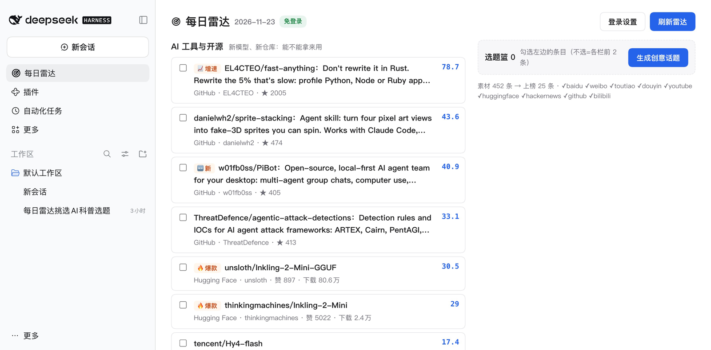

# dsh-radar · 每日雷达 + 创意选题（DeepSeek Harness 插件）

[](LICENSE)
[](https://github.com/cyber-ailab/dsh-radar/releases)
[](https://github.com/cyber-ailab/dsh-radar)

把「每天看一眼 AI 圈在热什么」和「把热点变成能开工的选题」装进 DeepSeek Harness（DSH）。免登录、零依赖、免费开源。



> 📺 [配套教程视频（B站，3 分钟看懂安装和用法）](https://www.bilibili.com/video/BV1wjyDz6EV6)
>
> 觉得有用，点右上角 ⭐ Star 就是最大的支持；想要哪个平台的榜单、哪种选题栏目，去 [Issues](https://github.com/cyber-ailab/dsh-radar/issues) 或 [Discussions](https://github.com/cyber-ailab/dsh-radar/discussions) 告诉我们。

- **免登录即用**：从抖音热榜、微博热搜、今日头条热榜、百度热搜、B站排行、Hacker News、Hugging Face 趋势、GitHub 新星、YouTube 频道抓取公开数据，不需要任何账号。
- **不抓的平台**：小红书、知乎、快手的榜单接口必须登录或签名，插件不做模拟登录，所以不抓。
- **按热度·增速·新鲜度打分**，分三栏出榜：AI 工具与开源 / 海外热议 / 国内热榜。
- **生成创意话题**：勾选条目，按「选题组装公式」规则粗筛成选题卡；一键交给 DSH 里的模型完善成可开工的选题（标题、开头台词、分段大纲、待核实事实）。
- **可选登录模式**：填你自己的 GitHub Token / B站 SESSDATA 提高抓取额度；只存本机、只读使用。

## 安装

需要 DSH 0.2.2 以上、Node 22 以上，以及 pnpm（DSH 装插件依赖它：`npm i -g pnpm`）。

```sh
# 1) 下载插件包（或自己构建：npm run pack）
curl -LO https://github.com/cyber-ailab/dsh-radar/releases/download/v0.1.0/dsh-radar-0.1.0.tgz

# 2) 装进你的 DSH profile（web 为例）
dsh plugin --profile web add ./dsh-radar-0.1.0.tgz

# 3) 重启 DSH，左栏出现「每日雷达」
dsh web
```

插件自带组合包声明（`dsh.bundle`），装上即启用，不用改 `cordis.patch.yml`。

## 使用

**面板**：左栏点「每日雷达」→「刷新雷达」（约 5–15 秒）→ 勾选感兴趣的条目 →「生成创意话题」→ 在选题卡上点「交给 AI 完善成选题卡」，会在新对话里起一份草稿。

**对话**：直接跟 DSH 说「看看今天的每日雷达」「把今天的热点变成 3 个选题」。模型会加载 `daily-radar` 技能，调用两个工具：

| 工具 | 作用 |
| --- | --- |
| `radar_daily` | 读最近一次日报；`refresh: true` 现抓 |
| `radar_topics` | 按选题公式把选中条目（`keys`）粗筛成选题卡，`programs` 指定栏目 |

**命令行**（不装 DSH 也能用）：

```sh
node src/engine.js run       # 抓取并打印今日雷达
node src/engine.js topics    # 用各栏前 2 条出选题卡
```

## 选题组装公式

```
选题 = 大背景(E事件 × P人物/公司 × K关键词/产品 × T话题 × S信号) ⊗ 栏目透镜 ⊕ 差异化角度
选题分 = 100 × (0.30·共振 + 0.25·新鲜增速 + 0.25·栏目适配 + 0.20·差异空间)
```

- **共振**：同一实体被多条素材、多个平台同时提到。
- **新鲜增速**：素材的发布时长和增速。
- **栏目适配**：栏目要求的那一元（比如人物深扒必须有人物）是否到位。
- **差异空间**：你自己做过的选题会扣分（在配置里填 `done`）。

默认带 5 个通用栏目：`explain`（2 分钟讲透概念）、`news`（30 秒快讯）、`person`（人物/公司深扒）、`test`（工具实测）、`fun`（整活/翻车）。可在配置里换成你自己的栏目。

规则粗筛是零成本的；要成稿级标题和大纲，交给模型完善。

## 配置

`~/.dsh-radar/config.json`（可选）：

```json
{
  "sources": ["douyin", "weibo", "toutiao", "baidu", "bilibili", "hackernews", "huggingface", "github", "youtube"],
  "youtubeChannels": [{ "id": "UCbfYPyITQ-7l4upoX8nvctg", "name": "Two Minute Papers" }],
  "topN": 8,
  "maxAgeDays": 7,
  "keywords": { "strong": "AI|大模型|Agent", "mid": "开源|融资|教程" },
  "programs": {
    "myshow": { "name": "我的栏目", "need": "K", "dur": "1:00", "angle": "对比实测", "struct": "成品先看 → 对比 → 结论",
                "hook": "同一个任务，{K}能打几分？", "tpl": ["{K}实测：{E}", "{E_s}之后我试了{K}"] }
  },
  "login": { "githubToken": "", "biliSessdata": "" }
}
```

也可以在 DSH 的 profile 里给插件传同样的配置。登录凭据也支持环境变量 `GITHUB_TOKEN`、`BILI_SESSDATA`。

## 数据与隐私

- 只请求各平台的公开接口；登录模式只把你自己填的凭据附在请求头里，只读，不做模拟登录、不绕过任何限制。
- 数据存在 `~/.dsh-radar/`（每日 JSON + Markdown），配置文件权限 600；界面里路径显示为 `~`，不暴露用户名。
- 某个平台这次没抓到时，用 6 小时内的缓存补上，并在条目上标「🕘缓存」。
- 只保存标题、链接和数字，不下载视频或图片。

## 开发

```sh
npm test       # 单测（离线）
npm run pack   # 产出 dsh-radar-<version>.tgz
```

源码零依赖：`src/sources.js` 数据源 · `src/rank.js` 打分 · `src/topics.js` 选题公式 · `src/engine.js` 引擎与 CLI · `src/index.js` DSH 宿主插件 · `src/client.js` 面板。

## 参与

- 🐞 抓不到、报错、榜单口径不对：[提 Issue](https://github.com/cyber-ailab/dsh-radar/issues/new/choose)
- 💡 想加的数据源、选题栏目、玩法：[Discussions · Ideas](https://github.com/cyber-ailab/dsh-radar/discussions)
- 🔧 想自己动手：看 [CONTRIBUTING.md](CONTRIBUTING.md)，带 `good first issue` 标签的都是新手友好；后续计划见 [Roadmap](https://github.com/cyber-ailab/dsh-radar/issues?q=label%3Aroadmap)
- 📜 版本记录：[CHANGELOG.md](CHANGELOG.md)

## 关于赛博实验室

我们是 **赛博实验室 Cyber Lab**，用 AI 拍剧、做工具，把做出来的东西开源。这个插件就是我们每天在用的选题工具。

- 抖音：**赛博实验室**（抖音号 `cyberlaboratory`）· [主页](https://www.douyin.com/user/MS4wLjABAAAA00XEpPcyhO1sKmolKQEWvU1TeyDcVwTG9lmeLguMQvc)
- B站：**赛博Laboratory** · [主页](https://space.bilibili.com/485924578)
- 📺 **教程视频**（从零安装、使用、打分拆解）：[B站 · 别再一个个平台刷热点了](https://www.bilibili.com/video/BV1wjyDz6EV6)

## 许可证

Apache-2.0
